# 🚀 Awesome Cloud Migration Management & Modernization ☁️

**A curated index of enterprise SaaS platforms, open-source orchestration engines, 7Rs assessment frameworks, and workload mobility tools.**

  
  
  
  
  
  
  

*Empowering cloud architects, DevOps engineers, and digital transformation leaders to discover on-premises assets, analyze application dependencies, score cloud readiness, and orchestrate cutovers with minimal downtime.*

**🌟 Star this repository to support community curation! 🌟**

---

## 📑 Table of Contents

- [🌐 Sector Overview & Market Dynamics](#-sector-overview--market-dynamics)
- [🏢 SaaS & Hosted Migration Management Platforms](#-saas--hosted-migration-management-platforms)
- [💻 Open-Source Migration Tools & Frameworks](#-open-source-migration-tools--frameworks)
- [🤝 How to Contribute](#-how-to-contribute)
- [💖 Support & Sponsorship](#-support--sponsorship)
- [📈 Star History](#-star-history)
- [⚠️ Disclaimer](#️-disclaimer)

---

## 🌐 Sector Overview & Market Dynamics

The global cloud migration services and software ecosystem is estimated between **$300B to $400B+** (with specialized core software, automated discovery, and orchestration tools accounting for ~$15B–$40B, expanding at a ~23–28% CAGR driven by generative AI infrastructure demands, data center consolidation, and hybrid-cloud deployments). 

The market structure is **moderately fragmented yet tiered**:
1. **Hyperscale Core Enablers:** Infrastructure vendors (Microsoft Azure, AWS, Google Cloud) concentrate the underlying migration orchestration, hypervisor replication, and landing zone automation within their proprietary hubs.
2. **Global Systems Integrators (GSIs):** Tier-1 enterprise transformation programs, legacy ERP refactoring, and complex re-platforming engagements are driven by global consulting partners.
3. **Independent Software Vendors (ISVs) & Open-Source Tooling:** Highly active niche players provide vendor-neutral discovery, code static analysis (blocker detection), continuous replication, FinOps cost forecasting, and multi-cloud workload mobility.

---

## 🏢 SaaS & Hosted Migration Management Platforms

*Sorted in descending order by company valuation / market capitalization.*

| Company / Platform | Company Scale (Valuation / Market Cap / Rev) | Specific Pricing & Starting Tiers | Free Tier & Free Trial Limits | Migration Focus & Key Capabilities |
| :--- | :--- | :--- | :--- | :--- |
| **[Azure Migrate](https://azure.microsoft.com/en-us/products/azure-migrate)** (Microsoft) | ~$3.1T Market Cap (~$245B Ann. Rev.) | **Free core platform** ($0.00 for discovery, assessments, & TCO planning; pay standard rates for target Azure resources consumed, e.g. Azure VMs from ~$0.0104/hr) | **Free forever**: Full asset discovery, agentless dependency analysis, and TCO business case modeling; includes $200 Azure credits (30 days) for cutover validation | Hyperscaler discovery and migration platform for VMware, Hyper-V, physical servers, SQL databases, and web apps to Azure. |
| **[AWS Transform](https://aws.amazon.com/transform/)** (Amazon AWS) | ~$2.2T Market Cap (~$600B+ Ann. Rev.) | **$0.035 / active agent minute** for custom code modernization; migration assessments & workload agents are $0.00; target infra billed at standard AWS rates | **Free tier**: 50,000 agent minutes/month free for AWS-managed .NET transformations; free assessments and workload planning; $0 platform fee for AWS MGN | Agentic AI-powered modernization and migration platform superseding AWS Migration Hub; automates code refactoring, mainframe modernization, and wave cutovers. |
| **[Google Cloud Migration Center](https://cloud.google.com/migration-center)** (Alphabet) | ~$2.1T Market Cap (~$350B Ann. Rev.) | **Free core platform** ($0.00 for discovery, TCO assessment, and migration planning; target GCP compute billed per second, e.g. e2-micro instances) | **Free forever**: Complete discovery and migration wave planning; includes 90-day free trial with $300 in Google Cloud credits for sandbox cutover testing | Centralized discovery, assessment, and migration hub for lifting and modernizing workloads into Google Cloud Platform. |
| **[IBM Turbonomic](https://www.ibm.com/products/turbonomic)** (IBM) | ~$215B Market Cap (~$62B Ann. Rev.) | **$37,000 / year** baseline subscription for up to 200 managed virtual servers (approx. ~$22–$25/VM/month) | **30-day free trial**: Full access for cloud and on-prem workload resource modeling and migration planning; no credit card required | Application Resource Management (ARM) providing multi-cloud migration planning, right-sizing, and reserved instance / savings plan cost modeling. |
| **[Atlassian Cloud Migration Assistant](https://www.atlassian.com/)** (Atlassian) | ~$52B Market Cap (~$5.2B Ann. Rev.) | **Free tool included** with Atlassian Cloud plans (Jira Cloud Standard starting at **$8.15 / user / month**) | **Free forever plan**: Up to 10 users and 2 GB storage; or **60-day to 12-month free Cloud Migration Trial** matching existing Data Center tier | Native migration utility (JCMA/CCMA) for migrating Jira, Confluence, and app data from on-premises Data Center to Atlassian Cloud. |
| **[Carbonite Migrate](https://www.carbonite.com/cloud-migration/)** (OpenText) | ~$7.8B Market Cap (~$5.2B Ann. Rev.) | **$500 / server node** starting license (Standard 60-day migration window; volume pricing and multi-packs available) | **Proof of Concept / Eval**: Custom evaluation license provisioned by sales (typically 30 to 60-day validity window per target node) | Byte-level, real-time replication migration engine enabling near-zero downtime cutovers across physical, virtual, and multi-cloud environments. |
| **[Flexera One Cloud Migration Planning](https://www.flexera.com/solutions/cloud-cost/cloud-migration-planning)** (Flexera / Thoma Bravo) | ~$2.8B Valuation (~$290M+ Ann. Rev.) | **$13,000 / year** starting annual scoped contract (FinOps modules scale at ~1–5% of managed cloud spend, or ~$50,000/yr for $1M spend) | **Custom Demo & Trial**: Guided sandbox and custom trial tenant access via sales request; no perpetual self-serve free tier | Workload placement, dependency mapping, multi-cloud cost modeling, and 6R strategy scoring. |
| **[CAST Highlight](https://www.castsoftware.com/products/highlight)** (Bridgepoint Group) | ~$150M (€139M) Valuation (~$50M+ Ann. Rev.) | **$6,800 / year** for a single named application (Complete Insights); portfolio Cloud Insights edition starts at **$30,800 / year** | **14-day free trial**: Access to pre-loaded sample application portfolio and code scanning engine for cloud blocker detection | Static source code intelligence engine scanning 50+ languages for cloud migration blockers, container readiness, and 5R disposition. |
| **[RiverMeadow](https://www.rivermeadow.com/)** | ~$50M–$100M Valuation (~$6M–$8M Ann. Rev.) | **$250 / workload instance** baseline migration fee (or bundled fixed-fee packages starting around ~$3,900 on AWS/Azure Marketplaces) | **Proof of Concept**: 30-day guided evaluation pilot with 5–10 workload migration entitlements upon sales consultation | Multi-cloud workload mobility and automated modernization platform providing pre-flight assurance, OS upgrades, and cutover automation. |

---

## 💻 Open-Source Migration Tools & Frameworks

*Sorted in descending order by GitHub stargazers count.*

### 1. **[Rclone](https://github.com/rclone/rclone)** 
- **License**: MIT
- **Category**: Multi-Cloud Data Migration & Storage Sync
- **Overview**: Known as the *"rsync for cloud storage"*, Rclone is the definitive open-source command-line utility to sync, migrate, and copy files across 70+ cloud storage backends (AWS S3, Google Cloud Storage, Azure Blob, OneDrive, Backblaze B2, SFTP, and on-premises storage).
- **Key Features**: Multi-threaded transfers, MD5/SHA-1 cryptographic integrity checks, bandwidth scheduling, chunked multipart uploads, and bidirectional synchronization.

### 2. **[Velero](https://github.com/velero-io/velero)** 
- **License**: Apache-2.0
- **Category**: Kubernetes Cluster-to-Cluster & Multi-Cloud Migration
- **Overview**: The industry standard for migrating Kubernetes application state, persistent volumes, and cluster resources between clouds, data centers, and on-premises clusters.
- **Key Features**: Point-in-time snapshotting, storage provider plugins (AWS EBS, Azure Managed Disks, Google Persistent Disks), scheduled backup sets, and cross-cluster resource filtering and replication.

### 3. **[KubeVirt](https://github.com/kubevirt/kubevirt)** 
- **License**: Apache-2.0
- **Category**: Workload Re-platforming (VM to Cloud-Native)
- **Overview**: Cloud-native virtualization add-on for Kubernetes that allows organizations migrating away from legacy VMware/Hyper-V hypervisors to run and manage traditional virtual machines side-by-side with containers.
- **Key Features**: Declarative VM lifecycle management, live migration between nodes, integration with Container Network Interface (CNI) and Container Storage Interface (CSI).

### 4. **[CloudQuery](https://github.com/cloudquery/cloudquery)** 
- **License**: Mozilla Public License 2.0 (Core / Open Source plugins)
- **Category**: Pre-Migration Asset Discovery & Infrastructure Assessment
- **Overview**: High-performance open-source ELT data integration engine that extracts configuration state from cloud providers (AWS, Azure, GCP), VMware, and Kubernetes into SQL databases (PostgreSQL, Snowflake, BigQuery) for asset auditing and migration readiness queries.
- **Key Features**: 300+ plugins, asset inventory generation, compliance assessment queries, and dependency auditing.

### 5. **[Cloudbase Coriolis](https://github.com/cloudbase/coriolis)** 
- **License**: Apache-2.0
- **Category**: Automated Lift-and-Shift VM Migration Engine
- **Overview**: Open-source migration-as-a-service orchestration engine specifically engineered to migrate running VM workloads between virtualization platforms and clouds (VMware vSphere, OpenStack, AWS, Azure, GCP, and Oracle Cloud).
- **Key Features**: Incremental disk replication, guest OS reconfiguration (driver injection, network setup), minimal downtime cutover, and automated replica staging.

### 6. **[Cloud Migration Factory on AWS](https://github.com/aws-solutions/cloud-migration-factory-on-aws)** 
- **License**: Apache-2.0
- **Category**: Large-Scale Wave Planning & Migration Orchestration
- **Overview**: An open-source, vendor-supported orchestration framework for medium-to-large enterprise migrations to AWS. Automates wave planning, server replication tracking, and cutover automation using AWS Application Migration Service (MGN).
- **Key Features**: Web management console, automated pre-requisite checking, automated multi-server agent installation, wave sequencing, and post-launch validation scripts.

### 7. **[Crane](https://github.com/migtools/crane)** 
- **License**: Apache-2.0
- **Category**: Kubernetes Workload & Namespace Migration
- **Overview**: Designed by the Konveyor community to migrate Kubernetes and OpenShift workloads between clusters, handling persistent volume sync and manifest transformations.
- **Key Features**: Export, transform, and apply pipelines for Kubernetes resources; plugin system for mutating cluster-specific specs during transit.

### 8. **[xmigrate](https://github.com/xmigrate/xmigrate)** 
- **License**: Apache-2.0
- **Category**: Open Infrastructure Migration Utility
- **Overview**: Python-based tool tailored for migrating on-premises workloads, virtual machines, and disk images directly to cloud infrastructure targets.
- **Key Features**: Blueprint mapping, agent-based discovery, and multi-disk synchronization.

### 9. **[Konveyor Tackle](https://github.com/konveyor/tackle2-operator)** 
- **License**: Apache-2.0
- **Category**: Application Portfolio Assessment & Modernization Toolkit
- **Overview**: An open-source application modernization and migration framework sponsored by Red Hat and the CNCF. Enables enterprises to assess entire application portfolios for container readiness and automated code refactoring.
- **Key Features**: 7Rs decision framework, static code analysis for migration blockers, automated dependency identification, and wave management.

### 10. **[Cloud Migration MCP Server](https://github.com/chrishorne74/cloud-migration-mcp)** 
- **License**: MIT
- **Category**: AI-Assisted 7Rs Assessment & Migration Planning
- **Overview**: Model Context Protocol (MCP) server enabling AI coding assistants (Claude Desktop, Cursor) to run structured 7Rs cloud migration strategy calculations, compliance guardrail checking, candidate scoring, and wave planning.
- **Key Features**: 7Rs strategy engine, 10-criteria readiness scoring (0–100), 30+ guardrails, ROM cost estimation (±50%), and automated Draw.io architecture diagram generation.

### 11. **[Skyferry](https://github.com/cubetribe/skyferry)** 
- **License**: MIT
- **Category**: Enterprise File & Drive Migration
- **Overview**: Rigorous, resumable Google Drive-to-Drive and bulk file migration utility built for high data volumes with zero data loss.
- **Key Features**: MD5 hash validation, split unit migration, state machine tracking, crash-resilient transfers, and webhook alerting.

---

## 🤝 How to Contribute

We welcome community contributions from cloud architects, engineers, and researchers!

1. 🍴 **Fork the repository** on GitHub.
2. 🌿 **Create a descriptive feature branch** (`git checkout -b add-migration-tool`).
3. 📝 **Add or update entries** in `README.md` keeping formatting clean, factual, and backed by official links:
   - For SaaS tools: include starting tier pricing, free limits, and company scale.
   - For Open-Source tools: include GitHub repository link, star badge, license, and primary capabilities.
4. 🚀 **Commit your changes** (`git commit -m "feat: add NewMigrationTool"`).
5. 📤 **Push to your branch** (`git push origin add-migration-tool`).
6. 📬 **Submit a Pull Request** with a brief summary of the project.

---

## 💖 Support & Sponsorship

If you find this curated cloud migration index helpful for your infrastructure planning, modernization projects, or research:

- 🌟 **Star the repository** to boost visibility and help others discover these resources.
- 🍴 **Fork the repo** to save it for your team's architecture playbook.
- 📢 **Share with your colleagues** on LinkedIn, X/Twitter, and engineering communities.
- ☕ **Support continuous maintenance & open research**: Consider sponsoring via the [GitHub Sponsor Dashboard](https://github.com/sponsors/ishandutta2007). Your support helps keep these pricing benchmarks and open-source ecosystems up-to-date!

  

---

## 📈 Star History

---

## ⚠️ Disclaimer

- This curated repository is community-maintained for informational and educational purposes. Mentions do not constitute commercial endorsements.
- Workload migration tools interact with mission-critical systems and confidential enterprise data. Always validate network security boundaries, IAM permissions, data sovereignty mandates (GDPR/HIPAA), and backup fallbacks before initiating cutovers.
- Cloud pricing, free tier thresholds, and marketplace listings fluctuate frequently; verify exact pricing cards with respective cloud providers and software vendors prior to production rollouts.
